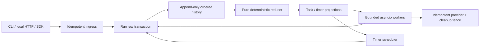

# Architecture

A definition is an immutable, topologically ordered DAG of activity, timer, signal,
and join steps. Canonical JSON, version and SHA-256 pin each run. Logical commands
have stable `step:NAME`, `compensate:NAME`, and `terminal:STATUS` IDs. The reducer
consumes one ordered event and emits commands without I/O or clock reads. Replay
checks command IDs at every event and rejects a changed definition at event one.

Every mutation locks the run row before its task projection. `_append` reconstructs
state, appends history, creates tasks/timers and updates status in one PostgreSQL
transaction. Recursive immediate join and pre-delivered signal completion stays in
that same transaction. Unique ingress keys, history sequences and command IDs are
additional constraints, rather than substitutes for transactional lock ordering.
Schedulers and workers select unlocked run rows with `FOR UPDATE SKIP LOCKED`.
Parallel activities execute outside transactions, so run serialization is confined to
short state changes. Worker slots and connection pools are bounded.

Claims increment the task epoch and persist an attempt. Completion and heartbeat
both lock the run/task, compare epoch and status, and require unexpired **database**
time. A stale worker may still perform an external operation; it cannot alter engine
state. Idempotent provider keys survive retries. Cancellation atomically cancels
ordinary task projections and writes a terminal provider fence before compensation.
That fence rejects a paused activity that resumes after cleanup. Other providers
must implement an equivalent contract to support the same cancellation guarantee.

Timers are rows indexed by deadline, not permanently waiting coroutines. Production
timer/lease eligibility uses `clock_timestamp()`; timer tests inject a time offset
into the SQL eligibility expression. It does not affect lease authority. Retry delay
is exponential and its exact value is recorded in history; no unrecorded jitter is used.
Early signals persist and are consumed when their step becomes ready. Signals are
broadcast to matching waits, not consumed from a destructive queue.

Compensation tasks have separate state/attempt rows. Failed retries leave the workflow
`compensating` and the failed cleanup visible; `retry_compensation` admits another
bounded batch. Full compensation requires all scheduled cleanup tasks to succeed.
The built-in provider's fence persists even if cleanup itself fails.

Persisted schema version is one; definitions/events are JSON, never pickle. There is
no general migration of already-running workflow definitions. An incompatible
algorithm/definition change must retain its existing version or reject replay.

The reference export shares one owned local output directory across its local workers;
partition/archive files are not a cross-host artifact storage service. Its activities
are idempotent local rewrites, while the provider is transactionally persisted.
