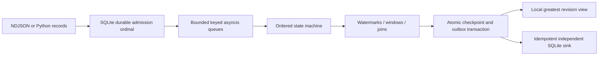

# Architecture

`model/envelope.py` owns the version-one wire format, canonical JSON, runtime validation, and BLAKE2b stable routing. `sources/ndjson.py` bounds NDJSON lines to 16 KiB and requires terminating newlines. The caller selects the source path explicitly. No sibling project is imported.

`ingress/journal.py` assigns ordinals inside FULL-synchronous SQLite WAL transactions. A batch is admitted atomically. Same-payload retries return the committed ordinal; conflicting reuse rolls back the entire batch. A postcommit acknowledgement failure leaves the data durable and retryable. Nothing deletes ingress rows, so offset identity remains available for replay; admission stops explicitly at configured budgets.

`event_time/policy.py` holds each registered input's watermark and idle status. All inputs are known before execution. The global watermark is `max(previous_global, min(active_input_watermarks))`; no active inputs leaves global progress unchanged. Resume cannot retract an earlier decision. End-of-input advances that input to the signed-64-bit maximum.

`runtime/asyncio.py` starts one queue/worker per fixed partition. Workers apply inexpensive pure map/filter functions. The coordinator applies prepared records in durable ordinal order. At most `capacity` futures are outstanding globally; each worker queue has the same finite cap. A checkpoint drains the current ordered prefix before publication. SQLite read/checkpoint work runs through awaited `asyncio.to_thread`; only one journal operation is submitted at a time. Cancellation propagates through TaskGroup and worker failures abort the run. Core event processing remains ordered; workers do not imply parallel CPU aggregate execution.

`runtime/engine.py` owns window and join state. Windows use Python floor division for negative times. Two min-heaps schedule close and expiration boundaries. A result is emitted at watermark close and after every subsequent accepted late modification. It retains the same logical key and increments its revision. Window state expires strictly after end plus lateness. Since accepted events require timestamp plus lateness at least the watermark, an expired window cannot be recreated by an accepted event.

The bounded interval join emits one result per opposite-stream input pair sharing a key, with inclusive timestamp distance. Pair keys use the exact reading/metadata admission ordinals. Join records expire strictly after timestamp plus interval plus lateness. Key-local retained records are scanned; a watermark control prunes expired state. State limits fail explicitly and require restoring the last committed prefix before changing budgets.

`Journal.publish` commits checkpoint position, serialized input/operator state, immutable deliveries, and local latest revisions in one transaction. The current uncommitted Engine is disposable after failure. Recovery sees either the previous prefix or the complete newly published prefix. Derived heaps rebuild from persisted window state. Pending outputs are in the outbox after publication, not redundantly stored inside the state JSON. The in-memory trace is a bounded recent-history diagnostic; full replay uses the journal.

`IdempotentSink` is a second SQLite database. Its immutable delivery table rejects conflicting payload reuse, while its latest table only advances to greater revisions. The caller marks the journal delivery acknowledged after `put` commits. Losing that acknowledgement causes a safe retry. This guarantee covers these explicit durable admission/sink contracts and does not promise exactly-once arbitrary HTTP effects.
