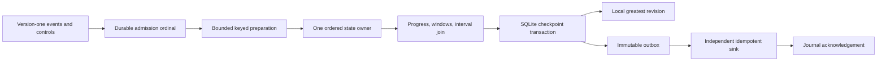
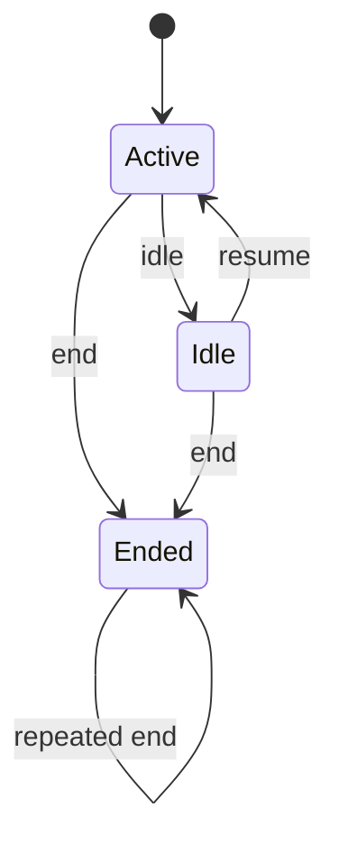

# Architecture

Current is a single-process event-time processor. SQLite provides durable ordering and atomic publication; Python owns the watermark, window, join and revision algorithms. No broker or scheduler infers missing controls.

## Admission and ownership

An admission identity is `(source_id, partition, source_offset)`. A batch commits all its new identities or none. Retrying the exact canonical wire payload returns the original ordinal; conflicting reuse rolls back the batch. Event IDs do not deduplicate different offsets. The ordinal orders events and controls together, which preserves the original lateness decisions across replay. `Record.wire()` resets its ordinal to zero; the destination journal assigns it from admission order.

`ingress/schema.py` derives expected SQLite metadata from the creation declarations. Opening checks format identity, column types/nullability/defaults, primary and unique keys, foreign keys, collations, conflict policies, table flags and tokenized CHECK expressions before initialization or writable pragmas. Triggers and unsupported extra schema objects fail closed. Empty-schema creation and its singleton format row commit together and are rechecked under the writer lock. The validator recognizes a supported database structure; it does not authenticate arbitrary supplied database contents.

Each Journal connection serializes its public operations with a reentrant lock. Reads and acknowledgements cannot accidentally join another thread's uncommitted publication transaction. Separate connections use SQLite transactions. Application code must not bypass this protection through `journal.db`; that connection is exposed for controlled diagnostics and tests.

A recovered Engine remembers the exact committed checkpoint bytes. Publication compares them with the database inside `BEGIN IMMEDIATE`, also rejecting a rewind or a position beyond admitted ingress. A stale owner raises `CheckpointConflict` before writing results. This is an optimistic stale-state fence, not a distributed lease: deployments still assign one Runtime owner to each journal. Acknowledgements do not change the checkpoint token. A successful publication with identical state is harmless.

## Event-time lifecycle

All input identities register before execution. Ordinary timestamps are integer milliseconds in `[-2**62, 2**62)`. Internal minimum/maximum sentinels represent initial and terminal progress. Only explicit watermark controls advance an unfinished input; event timestamps do not advance it automatically.

An idle input must resume before its next event. An ended input accepts only another end. Filtering never bypasses registration, contiguous-prefix or lifecycle checks. Controls cannot be filtered.

The global watermark never decreases. Take the minimum watermark among active, unfinished inputs and raise global progress to that minimum if larger. When every unfinished input is idle, freeze the previous global watermark. Advance to terminal infinity **only when every registered input has ended**. Removing an ended input from the active minimum must not turn a resumable idle input into permanent end-of-input.

For size 10 and lateness 2, this trace illustrates the distinction:

| Admitted action | Global watermark | Effect |
| --- | ---: | --- |
| A reading at 1, value 3; A watermark 10 | initial minimum | B still holds progress |
| B idle | 10 | Window `[0, 10)` emits revision 1, sum 3 |
| A end | 10 | B is unfinished and idle; retain correction state |
| B resume | 10 | Its old input watermark cannot retract global progress |
| B reading at 9, value 4 | 10 | Accepted late; revision 2, sum 7 |
| B reading at 20 | 10 | On time; event timestamps do not advance progress |
| B end | terminal | Close and expire remaining state |

Disposition is a single global decision before operators: reject if `event_time + lateness < watermark`; otherwise accept late if `event_time < watermark`; otherwise accept on time. The exact lateness boundary is accepted. Metadata events use the same policy. A filter consumes the ordinal without entering operator/disposition state.

## Windows and joins

Tumbling uses size as its step; sliding uses a positive divisor of size. Floor division handles negative timestamps. Windows are half open. A reading updates count, sum, minimum and maximum in each applicable window. Close boundaries and expiration boundaries have separate min-heaps. At `watermark >= end`, emit a dirty aggregate. Each accepted late update to a closed window emits the next revision of the same logical key. Expire strictly when `watermark > end + lateness`. An accepted event cannot resurrect an expired window: its timestamp is below its window end, while acceptance requires timestamp plus lateness at least the watermark.

The interval join matches opposite streams with equal keys and inclusive distance `abs(reading_time - metadata_time) <= interval`. Each pair appears once, when its second member is applied, with reading/metadata admission ordinals as its logical key and revision one. Retain a record until `watermark > record_time + interval + lateness`; beyond that boundary, no subsequently accepted partner can match it.

Canonical checkpoint state stores retained join lists in ingress order. A derived index groups them by `(key, stream, time // (interval + 1))`. At most three opposite-stream buckets intersect the inclusive interval, even for negative timestamps and interval zero. `heapq.merge` lazily merges those already ordered lists; exact distance filtering preserves pair membership and ingress delivery order. The merge uses constant auxiliary space and stops as soon as staging capacity fails. Restore validates canonical state before rebuilding the index. Watermark pruning rebuilds it from surviving records. This avoids scanning a large same-stream history for each new event, while genuine many-to-many output still costs one delivery per pair.

## Async execution and failure

The Runtime has one fixed queue/worker per keyed partition. Preparation applies deterministic, inexpensive, pure mapper/predicate functions; synchronous Python callbacks run on the event loop and do not provide CPU parallelism. Changing their meaning requires a new `pipeline_version` and a fresh job/rebuild plan.

At most `capacity` records/futures are outstanding globally. Preparation results, including exceptions, are ordered values. The owner consumes them in durable ordinal order, so a later callback failure cannot leak an unobserved future exception or overtake an earlier record. A callback raising `CancelledError` also terminates the run rather than leaving the consumer waiting for an unset result. One Engine rejects simultaneous Runtime owners.

SQLite reads and publication use `asyncio.to_thread`. Cancelling an await does not stop its thread. The Runtime therefore shields each submitted operation and, when cancelled, waits for it to settle before returning cancellation, including repeated cancellation requests. The caller can then close/reopen safely. **Cancellation does not imply rollback**: a publication may have committed before cancellation was observed. Recovery determines the actual prefix. A slow filesystem can delay cancellation completion. The shielded operation returns success/failure as data, avoiding a Python 3.14 cancelled-shield diagnostic for a later observed database exception. Cancellation retains that exception as its cause.

A failed/cancelled Runtime and an Engine whose mutating apply failed are disposable. They reject reuse/publication. Recover a fresh Engine from the committed journal; do not clear a private failure flag or edit its position. Pure validation errors occur before an apply mutation. Direct Engine usage remains the caller's responsibility; use the Runtime for the settled-I/O lifecycle.

## Publication and delivery

`COMMIT` is the linearization point for four pieces of processing state:

1. The exact contiguous processed position and serialized operator/progress state.
2. Every immutable delivery revision produced by that prefix.
3. The local latest result for each logical key.
4. Each delivery's unsent outbox row.

Pending outputs are represented in the outbox after publication, not duplicated in checkpoint JSON. Derived heaps/indexes and the bounded recent diagnostic trace are not persisted as authoritative state. Recovery validates topology, progress, aggregates, identities, resource counters and checkpoint/ingress position before returning an Engine.

| Failure boundary | Recovered state and outputs |
| --- | --- |
| Before transaction / during checkpoint staging / before COMMIT | Previous complete prefix |
| After COMMIT, including lost caller acknowledgement | Complete new prefix |
| Stale owner attempts publication | Current committed owner state remains unchanged |

External delivery spans two databases and is at least once. Call `pending(limit)`, commit `IdempotentSink.put`, then acknowledge in the journal. A crash after sink commit and before acknowledgement causes replay. The supplied sink atomically stores immutable delivery identity/payload and advances its latest view only for a greater revision. A conflicting retry fails; an older revision never overwrites a newer one. Job ID namespaces isolate otherwise identical logical keys from separate jobs.

Thus a committed prefix and its local results are atomic; repeated cross-database delivery has idempotent effects in the supplied sink. There is no atomic transaction across the two databases and no guarantee for arbitrary HTTP/email effects. Rebuilds that change accepted history need a fresh delivery namespace and explicit downstream reconciliation.

## Resource contracts

`state_limit` counts retained windows plus retained join records. Reserve a slot before allocating each new item; sliding window starts are generated lazily. This count is not a byte quota. A failure can leave partial private working state, which is poisoned and discarded. Restoring may change only `state_limit`, provided current retained state fits. A historical peak above the new limit remains a diagnostic and does not block recovery. Other Config fields retain their compatibility contract.

Staged outputs stop at `Journal.max_outbox`; publication additionally checks `unsent + staged` atomically. Draining an existing backlog can unblock publication. A single input producing more outputs than the staging budget requires a larger budget; changing checkpoint frequency cannot split that record. Genuine join fanout can be large even with indexed candidate lookup.

Journal limits also bound admitted record count and main-database pages. WAL/temp overhead needs extra disk or an OS quota. Ingress and immutable delivery history are retained. NDJSON import and raw ingress export use pages of 1,000; final `Journal.export()` and the batch oracle still materialize their complete result sets. These costs matter independently of bounded live queues/operator state.
