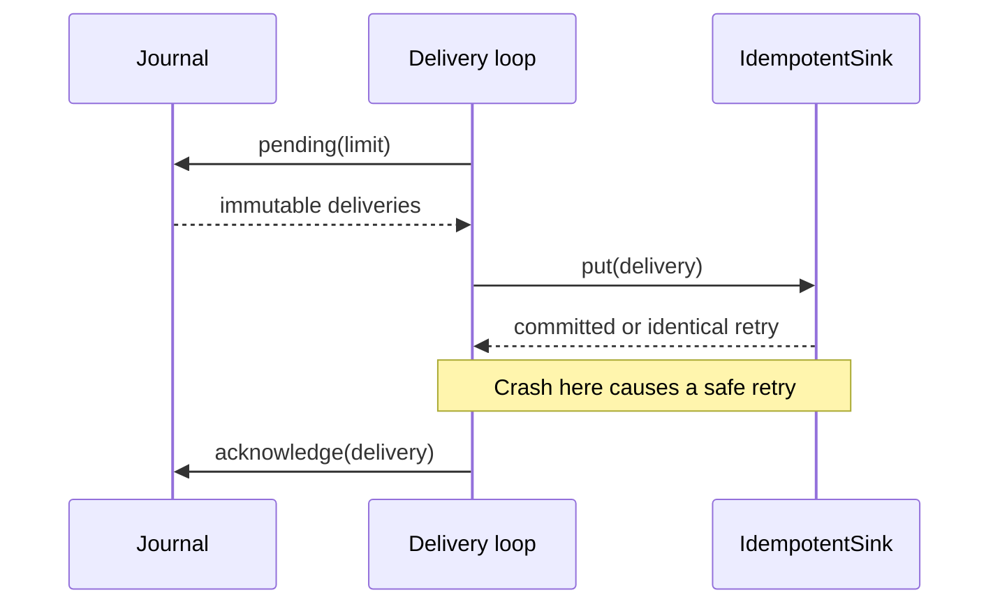

# Operations

Run one Runtime owner per journal. Current has no network service, daemon or required credentials. Linux is required for the process-exit durability suite and RSS probes. Supported compatibility targets are CPython 3.14.8 and 3.13.16.

## Install and validate

From this project directory:

```sh
uv sync --locked --python 3.14.8
uv run --locked --python 3.14.8 ruff format --check .
uv run --locked --python 3.14.8 ruff check .
uv run --locked --python 3.14.8 mypy src
uv run --locked --python 3.14.8 pytest
uv build --no-sources --python 3.14.8
```

The root `python scripts/portfolio.py check current` also builds an sdist/wheel and installs the wheel with runtime dependencies in a clean environment before running its crash/restart demo. To check 3.13.16, set `UV_PROJECT_ENVIRONMENT` to a separate absolute virtualenv, then run the same commands with `--python 3.13.16`. Keep `.venv` on 3.14.8 and run interpreters sequentially; they share build outputs.

## Normal processing and delivery

Keep source offsets stable. Admit records before acknowledging them upstream. If admission raises after commit, retry identical records: the returned ordinal is stable. Register the complete input topology in Config, including temporarily silent inputs. Journal explicit watermark, idle, resume and end controls; events do not advance watermarks themselves. Idle requires resume before the next event; end is terminal.

The local latest result is committed with its checkpoint. External delivery follows this sequence:



Do not acknowledge before sink commit. Acknowledgement must match both identity and canonical payload. Retry a lost acknowledgement; never synthesize a greater revision to suppress a conflict. Two jobs may share one sink because job ID is part of every identity. Use separate journals for their processing state. The supplied sink accepts reordered old revisions without replacing newer latest results.

Journal public operations serialize on their connection; separate connections are fenced at publication against stale checkpoint state. This protects integrity but is not owner election. In an async delivery loop call blocking journal/sink methods through an appropriate thread executor. Await Runtime cancellation before closing its Journal: Runtime waits for submitted database work to settle, and that work may have committed. Direct use of `journal.db` bypasses connection serialization.

## Recover a failed run

Stop/await the failed owner, discard its Engine, and recover a fresh one. Recovery chooses the committed prefix rather than guessing from the exception or local Engine position. Runtime failure, cancellation or a mutating apply failure makes the working Engine unusable.

| Symptom | Action |
| --- | --- |
| `CheckpointConflict` | Stop the unintended competing owner. Discard stale state and recover the current checkpoint. Do not force publication. |
| `BudgetExceeded`: unsent outbox backlog | Drain committed pending deliveries, then recover/retry the suffix. A checkpoint failure leaves its previous prefix intact. |
| `BudgetExceeded`: one record's staged fanout | Reopen with a larger `max_outbox`, then recover/retry. A smaller checkpoint interval cannot split a record's join fanout. |
| `MemoryError`: retained-state budget | Recover with a larger `state_limit`; retain all semantic configuration fields. Check watermark controls if retention is unexpectedly high. |
| `CancelledError` / interrupted publication | After the task returns, recover and inspect the actual prefix; cancellation is not a rollback acknowledgement. |
| Mapper/predicate failure | Preserve raw ingress. Restore the deployed deterministic functions and retry. A deliberate behavior change needs a new pipeline version and rebuild. |
| Unsupported checkpoint/schema or invalid persisted invariants | Preserve the database and diagnose/rebuild from raw ingress. Do not edit version/position/state to bypass validation. |
| SQLite disk exhaustion | Provide capacity, close/reopen with an adequate main-page budget, and recover/retry. Account for WAL and temporary files separately. |

For an operational state-budget increase, use the application's original Config:

```python
from dataclasses import replace

larger = replace(original_config, state_limit=2_000_000)
engine = journal.recover(larger, job_id=original_job_id)
# Run Runtime(journal, engine) with the original mapper and predicate.
```

Only `state_limit` may differ on checkpoint restore. A lower limit is also valid if current retained state fits; the recorded historical peak does not reserve live capacity. Journal budgets are constructor settings and may change after closing/reopening. A main-database page cap is not a filesystem quota; retain headroom for SQLite WAL/temp overhead and enforce an OS quota where needed.

## Rebuild a current-1/current-2 checkpoint

`current-3` rejects both earlier checkpoint versions. Their history can contain premature finalization after the last active input ended while another was idle, followed by wrongly rejected resumed events. This cannot be diagnosed reliably from final state alone. Never relabel a checkpoint. Stop the owner and preserve a SQLite-safe backup first.

For a journal stored as `/srv/current-old/current.sqlite` with the documented `identity-v1` pipeline, these commands export the unchanged raw ingress and saved full Config without restoring old state, then replay into a **fresh** directory with a new delivery namespace:

```sh
uv run --locked --python 3.14.8 python -m pp_current.cli inspect \
  --output /srv/current-old --ingress > /tmp/current-ingress.ndjson
uv run --locked --python 3.14.8 python -m pp_current.cli inspect \
  --output /srv/current-old --config > /tmp/current-config.json
uv run --locked --python 3.14.8 python -m pp_current.cli replay \
  --input /tmp/current-ingress.ndjson --config /tmp/current-config.json \
  --job-id device-rollups-v3 --output /srv/current-v3 \
  > /tmp/current-v3-results.json
```

Run the commands one at a time and stop on a nonzero exit. Select paths writable by the operator, and retain the source journal and sink until reconciliation finishes. The CLI expects the filename `current.sqlite` within `--output`; for another filename use the Python API below. `inspect --config` requires a saved checkpoint; if none exists, use the original application Config. Check the extracted Config against the deployment record before rebuilding. Admission and raw export stream in pages/batches of 1,000; final results JSON still materializes all latest results.

Without `--config`, replay uses default windows/lateness and only input IDs observed in the file; this is unsuitable for preserving arbitrary production configuration or registered silent inputs. The CLI refuses a custom pipeline version because it cannot reconstruct Python callables.

For a custom mapper/predicate, use the original deployment functions, original Config and pipeline version with the Python API. The core transfer is:

```python
import asyncio
from pathlib import Path

from pp_current import Journal, Runtime

old = Journal(Path("/srv/current-old/current.sqlite"), read_only=True)
new = Journal(Path("/srv/current-v3/current.sqlite"))  # choose a fresh path
try:
    after = 0
    while batch := old.read(after, 1000):
        new.admit(batch)  # wire identity is unchanged; ordinal comes from replay order
        after = batch[-1].ingress_ordinal
    engine = new.recover(original_config, job_id="device-rollups-v3")
    asyncio.run(Runtime(new, engine, mapper=original_mapper, predicate=original_predicate).run())
finally:
    old.close()
    new.close()
```

Set adequate Journal budgets for the retained ingress and expected fanout. Preserve exact control order. Histories with events after end, events while idle or unknown inputs must fail visibly; resolve them as an explicit data correction rather than silently dropping records.

Compare corrected dispositions, windows, revisions and downstream meaning before switching producers/delivery. The new job ID intentionally creates a separate sink namespace; it does not retract old results automatically. Existing immutable identities may have different payloads/revision histories, so replaying into the old namespace can conflict even when corrected values are right. Design the downstream replacement/retraction for the application before resuming delivery. `test_checkpoint_rebuild.py` executes the CLI procedure against an earlier-version checkpoint and verifies that the original bytes remain unchanged.

## Inspect, back up and clean

`inspect --output PATH` prints committed latest logical results; `--ingress` prints retained canonical NDJSON in ordinal order; `--config` prints saved configuration. These modes open read-only and do not initialize missing/unrelated databases. `--ingress` and `--config` are separate modes. Read-only SQLite may create WAL/shared-memory sidecars but does not rewrite application rows.

Use `Journal.read(after, limit)` with a nonnegative integer cursor and positive integer page size. Advance to the last returned ordinal. Negative limits and booleans fail explicitly. `pending(limit)` also requires a positive integer. Format/schema validation rejects unrelated layouts, incomplete schemas, altered constraints and triggers before initialization. Constraint validation detects structural incompatibility, not cryptographic tampering.

For online SQLite-safe backup, use `sqlite3.Connection.backup` into a fresh destination. Otherwise stop the owner and use SQLite `.backup`. Do not copy only a live main file while its WAL may contain committed data. Save code/config/pipeline version with the backup. Restore into a fresh path, recover with compatible configuration, and process its admitted suffix.

Demo/replay/benchmark require fresh owned directories. `clean-demo --output PATH` removes only that selected directory with the exact regular `.current-owned-demo` marker; symlink roots, ancestors and markers are rejected. Keep personal files outside demo directories. Ownership markers protect normal local operation, not hostile concurrent path replacement.

The standard million-event benchmark needs an exclusive resource lease and substantial transient disk/memory. Its marked bulk outputs are removed after compact evidence is saved. Retry interrupted runs in a fresh directory; do not replace historical reports. See [benchmarks](BENCHMARKS.md) for the smaller repeatable join probe and measurement limits.
