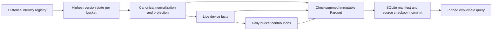

# Architecture

Input files flow through a bounded reader and strict contract validator into an uncommitted SQLite transaction. The `identities` primary key is `(namespace,key,version)` and its exact SHA-256 fingerprint remains authoritative for every accepted version. The separate `latest` relation stores only the highest explicit version per logical key, including tombstones. Obsolete accepted arrivals still enter the registry without invalidating the current bucket. File SHA-256 checkpoints are independent of event versions and include final byte offset (CSV uses logical record ordinal).

Persistent bucket identity is SHA-256 over compact sorted JSON `[namespace,key]` encoded as UTF-8, the first eight digest bytes interpreted big-endian, modulo the stored bucket count. There is no salt and no Python randomized hash. Format version 1 records this choice. Bucket-count changes require migration.

The fixed transform vocabulary supports a declarative acyclic graph. This version requires the named normalized→facts→daily shape; empty, incomplete or differently wired output configurations are rejected before staging. Per-node contract versions participate in semantic identity:

A node fingerprint includes its transform name, contract version, graph dependencies, complete payload schema/quality configuration, input partition fingerprints and implementation source digest. Parent fingerprints act as immutable partition-input identities. Global catalog snapshot numbers do not enter an unrelated bucket's identity. A semantic code/contract change conservatively rebuilds every affected node. A shared manifest validator requires format version 1, exactly the configured bucket set and the normalized/facts/daily node graph in every bucket, including zero-row buckets. Node file names identify their bucket and transformation; schema, count, size, dependency and digest metadata must be well formed. Publication, snapshot readers, explicit validation and recovery all enforce this structure. Manifest entries record fingerprints, input fingerprints, transform dependencies, physical Arrow schema, row count, SHA-256 and size. Reused entries keep their original file path and fingerprint, after their bytes, schema and row count have been verified against the previous manifest.

Normalization writes an explicit Arrow schema in bounded batches. Fact materialization drops versioned tombstones and projects device/day/value plus declared extension columns while preserving exact canonical payload. Daily transformation groups by day inside the stable key bucket. The query layer sums bucket contributions globally; therefore moving a key's day or deleting the last key naturally removes its old contribution when that bucket is rebuilt. Dataset quality rules reduce cached partition summaries; unchanged partitions reuse their count/min/max summaries. This is an explicitly global reduction over partition-local metadata.

Publication creates unique Parquet paths, closes writers, fsyncs files and the data directory, computes checksums and reads Arrow metadata, then commits one SQLite transaction containing historical identities, latest state, manifest, contract and ingestion checkpoint. WAL plus FULL synchronous mode defines the catalog commit boundary. Readers select a committed manifest and register a persistent pin under a writer transaction, then the query layer verifies each selected file against the committed size, SHA-256, schema and row count before DuckDB reads its explicit path. Hashing detects accidental modifications relative to the catalog; it is not a signature or protection against an attacker who can rewrite both catalog and data. The trusted local filesystem remains part of the contract. No query globs a directory.

GC first checks complete retained manifest topology and paths and durably removes unretained, unpinned catalog snapshots. It then reacquires the writer lock, recomputes references from every remaining manifest, and unlinks unreferenced owned Parquet files. This ordering is necessary: deleting files before committing catalog deletions could restore manifests pointing at missing files after a crash. Recovery uses the same reference reconciliation without changing retention. Identity history and tombstones are never discarded by GC.

Memory controls bound individual source records, Arrow batch cardinality and the configured batch-byte envelope; DuckDB separately receives memory and thread limits and an owned spill directory. Pinned query engines inherit the publication memory/thread settings recorded in their manifest and spill only into the lake-owned tmp directory. These settings are not a hard limit on process RSS: Python, Arrow and DuckDB have additional allocator/runtime overhead. Complete datasets are never accumulated in Python lists. CLI query output defaults to 100 rows; library queries stream batches. Peak RSS and engine settings are reported by the benchmark.
