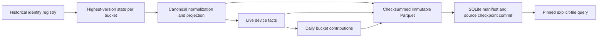

# Architecture

Input files flow through a bounded reader and strict contract validator into an uncommitted SQLite transaction. The `identities` primary key is `(namespace,key,version)` and its exact SHA-256 fingerprint remains authoritative for every accepted version. The separate `latest` relation stores only the highest explicit version per logical key, including tombstones. Obsolete accepted arrivals still enter the registry without invalidating the current bucket. File SHA-256 checkpoints are independent of event versions and include final byte offset (CSV uses logical record ordinal).

Persistent bucket identity is SHA-256 over compact sorted JSON `[namespace,key]` encoded as UTF-8, the first eight digest bytes interpreted big-endian, modulo the stored bucket count. There is no salt and no Python randomized hash. Format version 1 records this choice. Bucket-count changes require migration.

The fixed transform vocabulary supports a declarative acyclic graph. This version requires the named normalized→facts→daily shape; empty, incomplete or differently wired output configurations are rejected before staging. Per-node contract versions participate in semantic identity:

A bucket input digest streams sorted namespace, key and current event fingerprint from `latest`. It includes current versions and tombstones through their event fingerprint, while excluding source-file identity and unrelated global snapshot numbers. A node fingerprint includes transform name, contract version, graph dependencies, parent fingerprints, format/compression/thread policy and the package Python source digest plus PyArrow/DuckDB versions. A package code change conservatively invalidates every node. Physical payload fields participate in facts identity; normalized files use a fixed envelope schema. Validation policy does not change physical identity.

| Change | Normalized | Facts | Daily |
| --- | --- | --- | --- |
| New highest version, tombstone or day correction | Rebuild affected bucket | Rebuild affected bucket | Rebuild affected bucket |
| New obsolete identity or exact replay | Reuse | Reuse | Reuse |
| Nullable payload field addition without current event changes | Reuse | Rebuild typed projection | Rebuild through facts parent |
| Only quality bounds or live-row limits change | Reuse after revalidation | Reuse | Reuse |
| Node contract version changes | Rebuild node and descendants | Depends on changed node | Depends on changed node |

Daily conservatively depends on the complete facts identity, so even an irrelevant extension column can rebuild it. This is a remaining cost rather than a claim of minimal invalidation. A shared manifest validator requires format version 1, exactly the configured bucket set and the normalized/facts/daily graph in every bucket, including zero-row buckets. Node file names identify their bucket and transformation; schema, count, size, dependency and digest metadata must be well formed. Publication, readers, explicit validation and recovery enforce this structure. Entries record fingerprints, input fingerprints, dependencies, physical Arrow schema, row count, SHA-256 and size. Reused entries retain their paths/fingerprints after content verification.

Normalization writes an explicit Arrow schema in bounded batches. Fact materialization drops versioned tombstones and projects device/day/value plus declared extension columns while preserving exact canonical payload. Daily transformation groups by day inside the stable key bucket. The query layer sums bucket contributions globally; therefore moving a key's day or deleting the last key naturally removes its old contribution when that bucket is rebuilt. Dataset quality rules reduce count/min/max partition summaries on every publication, including checkpointed source replays and all-reuse plans. A normalized reuse can supply its cached summary, but a stronger rule still rejects the complete live state before publication. Contract construction copies fields into a read-only mapping, preventing caller mutation between compatibility checks, staging and publication.

Publication holds `BEGIN IMMEDIATE` from staging through commit. It creates unique Parquet paths, closes writers, fsyncs files and the data directory, computes checksums and reads Arrow metadata. It then reduces all candidate daily contributions and requires finite global `DOUBLE` totals: finite input values alone do not prevent overflow within or across buckets. After the final source rehash and manifest validation, one SQLite transaction commits historical identities, latest state, manifest, contract and source checkpoint. WAL plus FULL synchronous mode defines the visibility boundary. Before-commit failure rolls back newly staged catalog state and may leave synchronized orphan files. After-commit process failure can leave the caller uncertain despite successful publication; identical-source retry preserves identities/results but can create another metadata snapshot.

Readers select a committed manifest and register a persistent pin under one writer transaction, making selection atomic with retention. Each selected file is verified against committed size, SHA-256, schema and row count before DuckDB reads its explicit path. Daily queries validate the complete aggregate range before yielding, even with a one-row limit. `Lakehouse.validate()` holds the same kind of pin throughout hashing and aggregate checks. Hashing establishes consistency relative to a trusted catalog, not authentication against an actor who can rewrite both catalog and data. No query globs a directory.

An open snapshot owns its active query generators. Closing the handle closes those streams and DuckDB connections before removing its pin. Abandoning a generator frees its engine while the still-open snapshot continues retaining files. Handles/SQLite connections belong to their creating thread; concurrent readers need separate handles. Explicit context management releases pins predictably. A crashed reader can leave a stale pin; no automatic expiry risks deleting active-reader files.

GC first checks complete retained manifest topology and paths and durably removes unretained, unpinned catalog snapshots. It then reacquires the writer lock, recomputes references from every remaining manifest, and unlinks unreferenced owned Parquet files. Recomputing protects a publication entering between those transactions. Committing retention before unlink prevents a crash from restoring manifests whose files disappeared. Recovery uses the same reconciliation without changing retention. Identity history, source checkpoints and tombstones are never discarded by GC.

Memory controls bound individual source records, Arrow batch cardinality and the configured batch-byte envelope; publication, query and validation use a shared bounded DuckDB session policy and lake-owned spill directory. Query engines inherit settings from their manifest. These settings are not a hard limit on process RSS: Python, Arrow and DuckDB have allocator/runtime overhead. Complete datasets are not accumulated in Python lists. CLI output defaults to 100 rows; library queries stream batches. CSV scopes/restores its process-global parser limit under a process-local lock before yielding each record.

Lineage returns at most 1,000 versions by default, capped at 10,000 per page. An exclusive version cursor and first-acceptance snapshot cutoff freeze a traversal even when later sources insert obsolete versions below the cursor. The query joins identity provenance to source checkpoints, which survive materialized snapshot retention. Column lineage comes from the current manifest and carries its own snapshot label. Exact history remains unbounded in total storage; see [API](API.md) for pagination and handle ownership.
