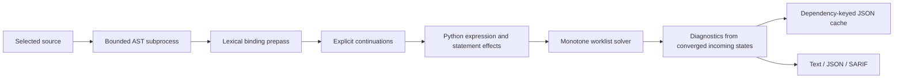

# Analysis architecture

PyTrace separates source ingestion, lexical binding, control-flow lowering,
abstract transfer, convergence and reporting. LibCST owns source transformations;
it does not supply the security analysis. No stage imports or executes a target
module, build hook, configuration file or plugin.

## Control flow is a separate representation

`cfg/blocks.py` lowers a suite into blocks with normal and exceptional successor
lists. The exits are distinct: block 0 is normal completion, 1 is return, and 2
is propagation of an uncaught exception. Every enclosing construct supplies
continuations for return, raise, break and continue.

An `if` branches at its condition. A `while` rechecks its condition on the back
edge. A `for` has separate operations for evaluating its iterable, advancing it
and binding its target. Iterable evaluation happens once; the target is bound
only when a body iteration begins. Exhaustion enters `else`, while `break` skips
it. Empty literal iterables cannot enter the body. Known nonempty literals must
enter at least once; other iterables conservatively permit zero iterations.

A `try` routes potentially raising protected operations to a handler dispatcher.
Handler types are treated as possible matches rather than inferred precisely.
Handlers can therefore receive writes made before a later failure. Exceptional
edges join a block's incoming, outgoing and recorded expression-prefix states.
This preserves a write made before a later call raises, even if another write
would have overwritten it on normal completion. `else` runs only on
the normal body continuation; failures in `else` bypass that try's handlers.
Exception aliases are bound on entry and cleared on every handler exit.

An explicit `raise` has two effects to route: successful evaluation raises its
chosen exception, while evaluation of the exception expression or `from` cause
can itself fail earlier. Both reach the enclosing handler/finally continuation,
but the latter also joins recorded expression-prefix states. A transient alias
written before that failure must survive even if normal expression completion
would overwrite it. Return expressions use the same prefix mechanism on their
exceptional route; break/continue have no operand evaluation.

A `finally` suite is lowered for each destination that can follow it. Pending
return, raise, break and continue all enter the suite. An abrupt statement in the
suite overrides the pending destination. Identical suite/continuation pairs are
memoized: nested cleanup must not create an exponential number of duplicate
graphs. A 20,000-block limit refuses excessive expansion before returning an
analysis result.

Pattern cases have separate selection and capture/guard operations. A failed
guard continues to the next case with its expression effects preserved. Capture
names are lexical locals. Descriptor protocols, class-pattern behavior and partial
bindings from a failed pattern remain coverage boundaries. `except*` subgroup
splitting and context-manager suppression are also outside the modeled exception
semantics; a coverage diagnostic remains visible.

## Abstract state and convergence

`analysis/lattice.py` defines a product value:

| Component | Meaning and bound |
| --- | --- |
| Shell/SQL taint | Two independent may-flow bits |
| Constructed text | Whether composition/interpolation may have built a value |
| Unknown | A behavior or value is outside the configured model |
| Callable targets | Up to eight canonical names; overflow becomes absorbing `*` |
| SQL method protocol | Independent may-sink fact, retained through aliases and target overflow |
| Source origins | Up to eight source lines, used as explanation metadata |

Assignments replace name state; joins retain possible flows. Missing names mean
unknown, so plain unknown bindings can be omitted from the environment. In
particular, defining 900 unrelated functions does not require carrying 900
identical unknown values through every function's graph. Imported or tainted
bindings remain explicit. Target overflow is canonicalized at construction, and
attribute lookup preserves `*` rather than manufacturing increasingly long names.

`analysis/solver.py` contains no Python-specific rule logic. It repeatedly applies
a transfer to reachable incoming states and schedules successors only when a
semantic key changes. Normal successors receive completed effects; exceptional
successors also receive any exceptional prefixes supplied by the language transfer.
Exceptional joins are computed only
when an exceptional edge exists. A 100,000-transfer budget fails explicitly
instead of returning an incomplete result. Origins do not extend the semantic
lattice or keep loops alive; they are bounded witnesses, not a complete trace.

After convergence, `analysis/engine.py` visits the reachable final incoming states
to emit diagnostics. Transient worklist states never determine the published
confidence. This matters when a short branch resolves a sink before a longer
branch introduces an unknown alias. The solver is independently checked against
exhaustive Boolean-state path exploration, including cycles and different
successor schedules.

## Python evaluation and lexical scopes

Expression transfer follows the modeled evaluation order: call receiver before
arguments, dictionary key/value pairs interleaved, subscript receiver before
index, and conditional joins for Boolean and chained-comparison short circuits.
Named expressions update the current environment. Assignment targets evaluate
their receiver/index effects; augmented assignment evaluates its target once.
Unknown method returns retain receiver taint while remaining uncertain.

`semantics/symbols.py` collects bindings before function analysis. Assignments,
imports, exception aliases, pattern captures and walrus expressions in an
inlined comprehension/default are included; comprehension iteration variables
and lambda-body locals do not leak into the enclosing function. Global and
nonlocal declarations remain distinct from local bindings. Parameters include
positional-only, keyword-only, variadic and keyword-variadic names.

Definition defaults, decorators and class bases execute in their enclosing
scope. Class suites have their own analysis environment and do not leak class
attributes into module globals. Function bodies are analyzed independently;
closure values are unknown and reported as partial coverage. The module's
terminal bindings approximate globals at function execution time. Import-time
call ordering, general heap state, runtime monkeypatching, annotation evaluation
and interprocedural return summaries are not proven.

## Reports, cache and edits

A reusable source map converts AST UTF-8 byte offsets to one-based Unicode
columns without splitting the entire source for every diagnostic. Findings have
stable identifiers, sink locations, confidence, coverage and bounded origin
witnesses. Suppression is recognized only in a real tokenizer comment on the
sink line. SARIF declares `unicodeCodePoints` and validates against the vendored
OASIS schema.

`cache.py` fingerprints source, imported local-module closure, module inventory,
configuration, interpreter/parser budgets and semantic implementation files,
including the solver and location model. Cycles use reachable-set closure.
Missing or invalid cache data rebuilds analysis. Cache publication uses an
exclusively created temporary and atomic replacement; it is disposable and does
not promise power-loss durability. Source/output aliases are refused before
writing. Concurrent hostile filesystem mutation is outside the editing model.

Codemods use LibCST qualified-name, scope, parent and position metadata. Plans
contain selected paths, original byte hashes and full replacements. Apply
recomputes eligibility and validates all files before writing backups and
replacing individual files. A multi-file apply is recoverable through its
journal, not transactionally atomic. Security diagnostics are never auto-fixed.

[Rule semantics](RULES.md) describes what each finding establishes.
[Decisions](DECISIONS.md) explains precision boundaries and rejected alternatives.
[Verification history](VERIFICATION.md) distinguishes current checks from earlier
acceptance and performance records.
