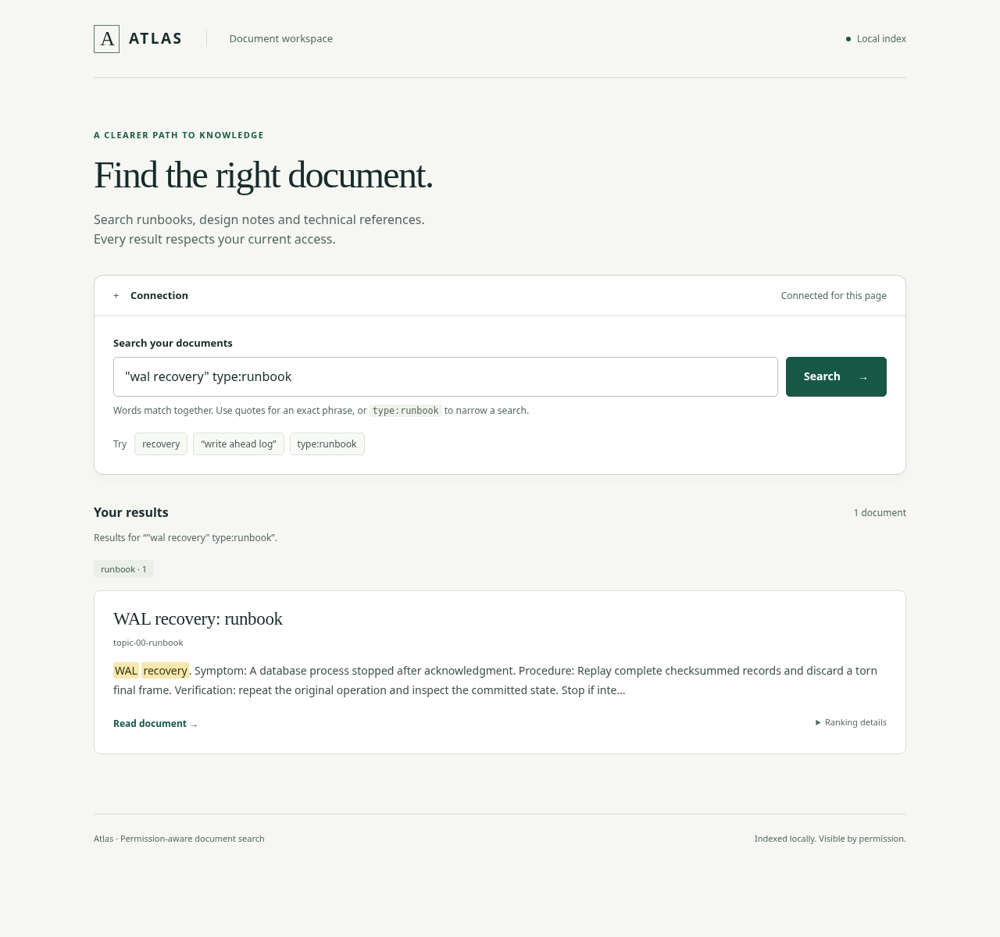

# Atlas

Atlas retrieves technical documents from a local, permission-aware lexical index.
It implements its own Unicode tokenizer, positional postings, BM25 scorer,
phrase planner, immutable index generations, and streaming segment merge.
SQLite supplies transactional catalog publication; FastAPI supplies the HTTP boundary.
No hosted search, model download, or external credentials are required.



The browser view supports keyboard navigation, paginated results, source-aligned
highlights and a document reader. See the [HTTP and browser guide](docs/HTTP_API.md)
for local serving, access bindings and request contracts.

```sh
uv sync --locked --python 3.14.8
uv run --locked python -m pp_atlas.cli demo --output /tmp/atlas-demo --seed 1729
uv run --locked python -m pp_atlas.cli clean-demo --output /tmp/atlas-demo
uv run --locked python -m pp_atlas.cli benchmark --profile ci --output /tmp/atlas-ci --seed 1729
```

The demo searches real documents, grants and revokes group access, replaces a
revision, deletes a document, merges immutable segments, and checks score
preservation. It emits escaped, attributed snippets and the generation/ACL revision
used for the response. Output directories must be empty or explicitly owned.

Python 3.13.16 and 3.14.8 are supported; Linux is the tested durability platform.
Filesystem directory fsync is required for ingestion. No code license has yet
been selected by the repository owner; see [provenance](docs/THIRD_PARTY.md).

Existing indexes need the [offline tokenizer rebuild](docs/OPERATIONS.md#tokenizer-upgrade-or-interpreter-switch).
The corrected tokenizer is versioned with its Unicode database; v1 indexes and
indexes from the other supported interpreter are refused before mutation.

```python
from pp_atlas import Document, Engine, Principal

engine = Engine("/tmp/atlas-index")
engine.upsert(
    "engineering",
    Document(
        "wal",
        "Recovery procedure",
        "WAL recovery replays committed records.",
        frozenset({"group:operations"}),
        {"type": "runbook"},
    ),
)
engine.set_groups("engineering", "alice", ["operations"])
result = engine.search(Principal("engineering", "alice"), '"wal recovery" type:runbook')
print(result.hits)
```

The Python API and administrative CLI trust the caller to select the authenticated
identity. HTTP requests use server-configured bearer identities; client-supplied
membership or tenant fields are rejected. See the [operations guide](docs/OPERATIONS.md)
for local serving, backups and deliberate segment-corruption reproduction.

- [Architecture and invariants](docs/ARCHITECTURE.md)
- [Decisions and limitations](docs/DECISIONS.md)
- [Acceptance mapping](docs/ACCEPTANCE.md)
- [Quality collection and benchmarks](docs/BENCHMARKS.md)
- [Engineering case study](docs/CASE_STUDY.md)
- [Current verification state](docs/VERIFICATION.md)
- [Bounded query allocation diagnostic](benchmarks/README.md)

## Development checks

```sh
uv run --locked ruff format --check .
uv run --locked ruff check .
uv run --locked mypy src
uv run --locked pytest
uv build
```

Keep interpreter environments separate when checking 3.13 compatibility. Historical
performance and relevance measurements identify their tested revision; a source change
does not turn an earlier result into a current throughput or relevance claim.
