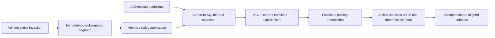

# Architecture

Each tenant has a SHA-256-named directory containing its own SQLite catalog and
segments. Tenant text is never joined to a filesystem path. A catalog transaction
captures generation, segment names/checksums, active revision identities,
ACL revision, and all server-side group memberships. Subsequent scoring uses this
same snapshot. ACL updates are independently transactional and need no index rebuild.

Ingestion tokenizes before publication, writes a gzip JSON-lines segment, fsyncs
its contents and directory, and only then commits the new segment list and active
revisions under `BEGIN IMMEDIATE`. SQLite uses WAL and synchronous FULL. A crash
before publication leaves an ignored orphan. A reader never infers current versions
from segment order: only the pinned catalog revision can select a record.
Deletes remove active metadata and increment generation; retained files cannot
resurrect their contents. Revisions use unique random identities, not content
hashes that could accidentally reuse obsolete metadata.

Segments are sorted by document ID. Merge uses `heapq.merge` over independently
streamed files, retaining only the active revision. It publishes with a generation
compare check in the same catalog transaction. A stale merge fails for retry;
concurrent document writes cannot be discarded. ACL-only changes remain intact.
Old files are retained so already pinned readers remain valid. There is no online
file garbage collector or unbounded promise of disk space recovery.

The in-memory reader loads current revisions and positional postings once per
generation. It checks referenced-file size/mtime signatures on every request and
revalidates checksums when loading or when signatures change. Filesystem ownership
is trusted; a privileged attacker can defeat stat-based cache invalidation. Every
cold load, restart, merge and readiness reload verifies recorded SHA-256 digests.
Missing files, invalid versions, missing active revisions, and checksum failures
fail clearly rather than silently returning incomplete results.

`visible_set = authorized current revisions intersect explicit filters` precedes
candidate selection, phrase matching, facets, counts and scoring. N includes empty
visible documents, average length includes their zero lengths, and df counts only
visible revisions. An empty visible set or all-empty corpus scores zero. The
query is conjunctive; repeated unquoted terms contribute once. Quoted repeated
terms still require repeated adjacent positions. Empty queries list authorized
filtered documents with zero score, ordered by ID. Ties always use stable ID.

Results include term score contributions and visible N, df, average length, k1/b.
The 128-entry LRU includes tenant, subject, ACL revision,
generation, normalized query, filters, ranking settings and pagination. Revocation
changes its identity before any new request can use a prior result. A request
already holding a snapshot may finish under that snapshot. Index loading and
ranking run in synchronous FastAPI handlers, off its event loop.

The tokenizer NFKC-normalizes grapheme-like clusters and casefolds, joins Unicode
letters/numbers/marks, and keeps original character bounds. It handles Hangul
starter composition, compatibility ligatures and combining accents. Snippets
escape source before inserting controlled `<mark>` elements. They never splice
normalized-character offsets into original text.

The HTTP export adapter uses `export_page`: it computes visibility and the total
from one snapshot, then constructs only the requested page of public document
records. The current-generation index remains materialized in memory; bounded
export projection does not remove that separate scaling limitation.

The browser view loads local stylesheet/script assets, applies a restrictive CSP,
and renders document text as text. Controlled snippet marks are the only HTML
retained in results. Responses disable caching, framing and content-type sniffing.
Bearer values have no form field name, never enter a URL or browser storage, and
are cleared with results on connection changes and page exit.
