# Architecture and contracts

The domain has nine principal immutable records: `DatasetVersion`, `SplitManifest`, `ExperimentSpec`, `RunRecord`, `EvaluationReport`, `ArtifactManifest`, `ModelVersion`, `PromotionDecision` and `DeploymentGeneration`. A `ServingSnapshot` additionally binds a fitted pipeline to the artifact, model version and applied generation used for one request.

```mermaid
flowchart LR
  G[Seeded equipment generator] --> D[Dataset content digest / Parquet]
  D --> S[Frozen membership + split policy]
  S --> T[Train-only imputer / scaler / estimator]
  T --> A[Staged skops content + immutable manifest]
  A --> E[Validation report bound to artifact + data + split]
  E --> R[SQLite registry / frozen gate policy]
  R --> C[BEGIN IMMEDIATE / expected-generation comparison]
  C --> L[Load + hash + type + compatibility checks]
  L --> P[Atomic serving snapshot swap]
  P --> Q[Prediction + actual version + applied generation]
```

## Data and evaluation

Times are numeric hours since the synthetic epoch. Every observation has a stable numeric row ID and asset ID, observation time, per-feature availability times, label availability time and a six-hour fault horizon. Features have documented numeric types and a `label_derived` flag. The generator uses asset effects and slow time components, Bernoulli faults, class imbalance, missing sensors and an optional late-period shift. It is original synthetic data.

The temporal split asks how the existing fleet performs on future observations. Boundaries are fixed at observation-time quantiles 0.6 and 0.8. Training labels must be available **strictly before** the validation boundary. Validation observations begin at boundary + two-hour embargo and their labels must be available strictly before the test boundary. Test observations begin at test boundary + two hours. Rows inside purge/embargo regions are intentionally unused. Asset overlap is allowed under this question. A separate deterministic entity split hashes asset IDs into 60/20/20 groups, enforces disjoint IDs, and explicitly asks unseen-asset generalization instead of future forecasting.

Membership is frozen before training. Median imputation, missing-value indicators and scaling are fitted through one sklearn pipeline using training rows only. The prior, logistic and depth-bounded tree all follow this path. Validation reports include count, positives, class balance, average precision (reported as PR-AUC), ROC-AUC when both classes exist, Brier score, ten calibration bins, fixed asset-modulo and missingness slices, and a seeded asset-cluster percentile bootstrap. Small slices are flagged. The whole asset is resampled to retain within-asset correlation; this does not estimate all future fleet uncertainty.

The default promotion policy is a frozen validation-v1 policy: at least 100 observations and 10 per class, PR-AUC at least 0.35, ROC-AUC at least 0.65 and Brier at most 0.20. These are demonstration thresholds set before fitting. Undefined, missing and nonfinite required metrics fail closed. Final-test labels cannot authorize promotion. The demo selects between the fixed logistic/tree candidates on validation PR-AUC and computes the test report only afterward. The staged CLI refuses final-test evaluation before the candidate has been promoted.

## Identity and persistence

Canonical JSON is sorted, compact, UTF-8 and refuses NaN. Dataset identity covers schema, horizon, generator, seed and shape/dtype/bytes for every contract array. Split identity includes dataset identity, exact membership, boundaries, policy and scientific question. Experiment identity includes data, split, own-code digest, preprocessing, estimator/hyperparameters, seed and lock digest; timestamps and retry IDs are separate attempt metadata.

Skops bytes have their own SHA-256. The artifact identity hashes a versioned manifest binding those bytes to run/data/split/schema and exact numpy/sklearn/skops versions. Serialization may differ between repeated saves; equal semantic experiments do not promise byte-identical artifacts. Local filesystem assumptions are POSIX rename, fsync and SQLite FULL synchronous mode on a functioning filesystem. Publication synchronizes model and manifest files, then their stage directory, before rename; it synchronizes the artifact-store directory afterward. Syncing only the files would leave their directory entries outside the durability boundary. Registration occurs only after published content verifies. A crash can leave an unreferenced stage or immutable artifact; no registry reference is created for an unpublished stage.

SQLite files carry application_id 1347430193 and schema user_version 1; unrelated and future formats are refused. Canonical run specifications and attempt records also carry format version 1. SQLite uses WAL and `BEGIN IMMEDIATE` for initialization, registration and promotion. Every accepted/rejected promotion records candidate artifact, data, split, report, policy and expected generation. A deployment insert and its audit decision commit in the same transaction. Rejected generation comparisons are audited and committed without changing deployment. Rollback requires a previously deployed model and creates a new generation; no model history is deleted.

## Serving

Candidate deserialization occurs outside the serving lock. Hashes, persistence-library versions, explicit reviewed types and exact supported pipeline components are checked. The supported step order is median imputer with missing indicators and retained empty features, standard scaler, then the declared classifier. Manifest feature names are unique nonempty strings, and their count must match the fitted pipeline. Reordering or duplicating supported components does not satisfy that contract. A probe runs before publication. A completed load then checks the authoritative requested generation while holding the snapshot lock. A slow earlier load cannot replace a newer generation. Each prediction captures one snapshot and uses its pipeline **and** metadata until that request completes, including when a swap occurs mid-inference.

Readiness reports requested and applied generations separately. Failed candidate loads retain an older valid snapshot with its original metadata, or predictions are unavailable when no snapshot exists. The FastAPI lifespan watcher loads a new requested generation once; `/refresh` explicitly retries a failed current generation. Synchronous model work runs outside the event loop. Shutdown stops the watcher. The service has no model upload or pickle/joblib path.

## Monitoring and boundaries

Drift compares schema, missingness, standardized mean shifts and decile-bin PSI against a reference batch. It describes distributions, not model accuracy without labels. Requests are limited to 2 MiB, 1–1000 rows and exact sensor keys; JSON null is an explicit missing value. Finite numbers are accepted; booleans, numeric strings and nonfinite values are refused. The ASGI body middleware counts actual received bytes, rejects an oversize body before dispatch, and forwards accepted content through the supported receive protocol. Validation errors omit input values, including NaN/infinity values that cannot be serialized in a JSON response. The API is a local, unauthenticated loopback demonstration. Dataset inputs are constrained to exact Arrow column types and unique names, nonnull required identity/time/label fields, the versioned Parquet contract and matching embedded content identity. Types are checked before conversion so fractional IDs/labels cannot silently truncate. Normal cleanup removes only an owned demo directory with recognized entries; unexpected files block deletion.
