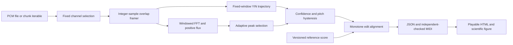

# Architecture

`model.py` defines AudioSpec, FrameConfig, PitchFrame, OnsetEvent, NoteEvent, ReferenceNote, AlignedNote, AnalysisConfig and AnalysisReport. Public `analyze` converts PCM and delegates to `analyze_chunks`. The latter never resets estimator or onset history at input boundaries. No sibling packages or hosted models are imported.

Framing uses starts 0,256,... below the original sample count. Frames are 2,048 samples; final windows are zero padded once. Pitch timestamps are centers, and lookahead is a full frame (46.44ms at 44.1k or 42.67ms at 48k). Note/event times are integer samples. Offline onset peak detection uses a +/-8-frame adaptive neighborhood. This is an offline product; no latency or real-time guarantee is claimed.

YIN uses identical overlap width N-maxlag for every difference lag, cumulative mean normalization, first threshold crossing .15, local minimum descent and bounded parabolic interpolation. Lag limits correspond to 78–1,400Hz, covering baseline E2–E6; accepted periodicity confidence >=.8. RMS below .003 is silence. FFT correlation is a NumPy kernel, while lag logic and musical decisions are original. Numeric differences are explicitly checked against direct squared differences.

Onsets use positive magnitude spectral flux, a local median floor, local maxima, a 100ms refractory period and rising frame energy. The energy gate prevents abrupt note-off leakage from becoming an onset. Decoding permits two missing frames, requires >=80ms, and changes pitch after a 60-cent departure from the active MIDI pitch plus an abrupt trajectory change or detected reattack. Smooth bends stay within their event, exposing spread instead of invented stable segments. Credible onset events also split repeated same-pitch attacks, including adjacent plucks with no intervening silent frame. Split boundaries are clamped to prevent overlapping monophonic notes. Estimated median frequency and 90th–10th percentile spread remain available; smooth bends need not imply a new stable note.

Alignment is O(reference notes × detected notes) time and memory. Insertion/deletion cost 1.2, pitch substitution 1.5 per semitone, timing penalty capped at 2, low confidence adds 3. Gaps are explicit. Optional caller-specified tempo_scale [.5,2] maps reference positions locally; automatic tempo estimation is outside the baseline. Tie-breaking is match, deletion, insertion. JSON score schema 1 accepts onset/duration in seconds or beats and an explicit tempo_bpm.

The default alignment budget is 4,000,000 matrix cells, including boundary rows
and columns. It is checked before NumPy allocation; callers must explicitly
increase `max_cells` for larger phrases. IDs, ordered integer positions and
finite confidence/cents are validated before scoring. Score JSON has independent
byte, depth and note-count limits so parsing a reference cannot request an
unbounded alignment allocation.

The sample working buffer is at most caller chunk size +2,047 samples; an emitted frame copy is another 2,048 samples. A bounded FFT scratch array and one prior magnitude vector are additional constant space. Output pitch/flux lists grow linearly with recording duration; DP alignment grows with event counts. Report generation is intentionally for a selected short clip and may retain that clip and image. Long benchmarking invokes only the bounded-input analysis pipeline.

Reports include encoded audio, authentic Matplotlib figures, reference/detected notes, confidence, cents/spread, explicit extra/missing alignment and source provenance. SciPy verifies transforms; SoundFile supplies PCM codecs; mido serializes standard MIDI. A separate byte-level checker verifies the generated MIDI without mido.

`reports/render.py` prepares the signal plot and presentation values;
`reports/analysis.html` is a packaged, self-contained HTML template. It provides
labeled native playback, explicit preview scope, a responsive recording overview,
table captions and scoped headers, keyboard navigation and empty-note states.
External metadata is escaped before interpolation. Figures are closed even when
plot serialization fails. Audio and plots are embedded; download links refer to
the companion output files.

MIDI export rounds sample times to 480 ticks/beat with an explicit tempo (default 500,000 microseconds/beat). A positive sample interval that rounds to zero ticks is rejected before writing, rather than emitting an invalid note-off-before-note-on lifecycle. At coincident boundaries, note-off precedes note-on. The independent byte checker accepts any positive 24-bit tempo and verifies note lifecycles; tempo-specific timing is independently checked with mido.
