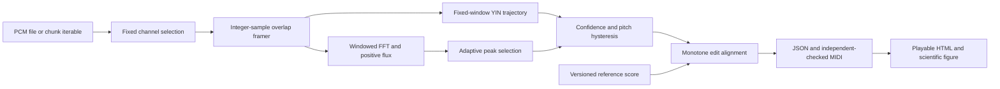

# Architecture

`model.py` contains the public records and configuration. `analyze` selects mono
samples and delegates to `analyze_chunks`, which owns a framer, one previous
spectrum and retained output trajectories. Input boundaries never reset signal
history. Estimation, segmentation, alignment and evaluation have separate
responsibilities: an alignment match is not a pitch estimate, and the evaluator
does not use the production aligner to establish accuracy. The numerical model
and its validation limits are specified in [METHODOLOGY.md](METHODOLOGY.md).

## Framing and state ownership

For input length `L`, frame size `N` and hop `H`, the authoritative start grid is
`range(0, L, H)`. The default is `N=2048, H=256`; final windows are zero padded.
Pitch timestamps are `start + N//2`, including padded tail windows. Decoding
rejects centers beyond the original recording. A full frame takes 46.44 ms at
44.1 kHz or 42.67 ms at 48 kHz to acquire from its start; onset selection also
uses eight later frames. These are offline timestamps, not a real-time latency
guarantee.

`Framer.feed` copies input and records its length immediately. Its `FrameBatch`
owns exclusive access until exhausted or explicitly closed. Each next call
advances the start and overlap buffer before returning an independent frame.
Closing early preserves remaining samples without replaying the last frame.
Once finalization starts, only an empty final feed may resume an interrupted
batch; no further input can be appended. Draining the last tail frame closes the
framer and releases its buffer. This makes caller buffer reuse, partial
consumption and flush ownership explicit instead of relying on generator
suspension or garbage collection.

## Pitch, attacks and note events

YIN compares identical overlap width `N-maxlag` at every lag, then performs
cumulative mean normalization, first threshold crossing at .15, local minimum
descent and parabolic interpolation bounded to half a lag. Lag limits correspond
to approximately 78–1,400 Hz, covering the default E2–E6 target. Accepted
periodicity confidence is at least .8; RMS below .003 is silence. Each threshold
is configurable. Normalization divides every positive cumulative energy; it has
no absolute energy epsilon that would change a dimensionless periodicity
decision when amplitude units change. Exactly zero energy remains unvoiced.
FFT correlation supplies the dot-product kernel and is checked against direct
squared differences.

Onsets use positive magnitude spectral flux. Both the median and relative-peak
floors use the same ±8-frame neighborhood, so a distant future peak cannot erase
an earlier decision. A centered three-frame RMS average supplies the rising
energy gate: it suppresses pitch-period ripple and note-release spectral
leakage. Local maxima are considered in chronological order with a 100 ms
refractory period. This intentionally limits resolution for rapid repeated
attacks.

Decoding allows two missing frames and requires an event of at least 80 ms.
Changing pitch requires a 60-cent departure from the active MIDI pitch and
either a greater-than-35-cent step from the previous voiced frame or a nearby
credible attack. Credibility is consistently `onset.confidence >= .5` for
splitting, boundary snapping and reattack support. A weak peak cannot move a
boundary through a secondary code path. Credible repeated-pitch attacks also
split notes without an intervening silent frame. Nearest-event queries use a
sorted index and binary search; they do not rescan every attack for every frame.

An initial event boundary is the first/last voiced center minus/plus half a hop.
Its start may snap to a credible attack within 80 ms. Boundaries are clamped to
the recording and previous event to maintain monophony. A note summarizes median
frequency, nearest MIDI pitch, cents relative to that MIDI pitch, mean confidence
and 90th–10th percentile cents spread. Smooth bend/vibrato can remain one event;
its nominal pitch summary and instantaneous frame trajectory answer different
questions.

## Edit alignment

Alignment minimizes a defined monotone edit cost over ordered reference and
detected notes. Insertion/deletion cost 1.2; match cost is 1.5 per nominal MIDI
semitone plus onset displacement in seconds capped at 2, plus 3 for confidence
below .8. Thus an uncertain detection is cheaper to leave unmatched than to
force into an authoritative match. Cents and duration are diagnostics, not cost
terms. Exact ties prefer match, deletion, insertion at each traceback cell.

Caller-specified `tempo_scale` in `[.5, 2]` maps reference sample positions about
sample zero. It does not infer tempo, estimate an offset or retime input events.
Traceback reports detected onset minus rounded scaled reference onset and a
signed cents difference. Matched costs are recomputed directly instead of
subtracting nearly equal cumulative costs. JSON score schema 1 accepts
onset/duration in seconds or beats and explicit `tempo_bpm`.

Time remains O(reference notes × detected notes). Traceback retains one operation
byte per matrix cell; scores use two O(detected notes) rows. The hot loop uses
scalar comparisons without constructing a NumPy array for every three-way
choice. An exhaustive all-path oracle verifies cost optimality independently of
the production recurrence, with explicit tie and tempo tests.

The default alignment budget is 4,000,000 matrix cells, including boundary rows
and columns. It is checked before NumPy allocation; callers must explicitly
increase `max_cells` for larger phrases. IDs, ordered integer positions and
finite confidence/cents are validated before scoring. Score JSON has independent
byte, depth and note-count limits so parsing a reference cannot request an
unbounded alignment allocation.

## Resource and reporting boundaries

When every nonfinal batch is drained before the next feed, the sample buffer is
at most caller chunk size +2,047 samples; one emitted frame is another 2,048
samples. Closing early leaves pending frames in that buffer, so repeatedly
appending without draining can grow it. FFT scratch and the prior magnitude
vector have fixed sizes for a configuration. Retained pitch/flux/event lists grow
with recording duration. The default 4,000,000-cell alignment limit bounds
traceback payload near 4 MB plus cost rows and records; it does not bound output
trajectories. Report generation intentionally retains a selected clip and image.

Reports include encoded audio, authentic Matplotlib figures, reference/detected notes, confidence, cents/spread, explicit extra/missing alignment and source provenance. SciPy verifies transforms; SoundFile supplies PCM codecs; mido serializes standard MIDI. A separate byte-level checker verifies the generated MIDI without mido.

`reports/render.py` prepares the signal plot and presentation values;
`reports/analysis.html` is a packaged, self-contained HTML template. It provides
labeled native playback, explicit preview scope, a responsive recording overview,
table captions and scoped headers, keyboard navigation and empty-note states.
External metadata is escaped before interpolation. Figures are closed even when
plot serialization fails. Audio and plots are embedded; download links refer to
the companion output files.

Rendering captures the encoded mono WAV once, decodes it independently, and
checks its sample rate and exact samples against the plotted clip before
allocating a figure. The HTML and JSON record the encoded playback SHA-256,
sample count, rate and full/prefix scope. A source recording's hash is separate:
a first-30-second mono preview is not byte-identical to its original stereo or
long recording. The caller must keep source files immutable during analysis.

MIDI export rounds sample times to 480 ticks/beat with an explicit tempo (default 500,000 microseconds/beat). A positive sample interval that rounds to zero ticks is rejected before writing, rather than emitting an invalid note-off-before-note-on lifecycle. At coincident boundaries, note-off precedes note-on. The independent byte checker accepts any positive 24-bit tempo and verifies note lifecycles; tempo-specific timing is independently checked with mido.
